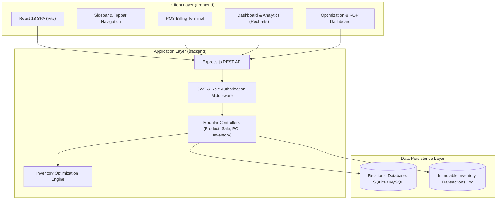
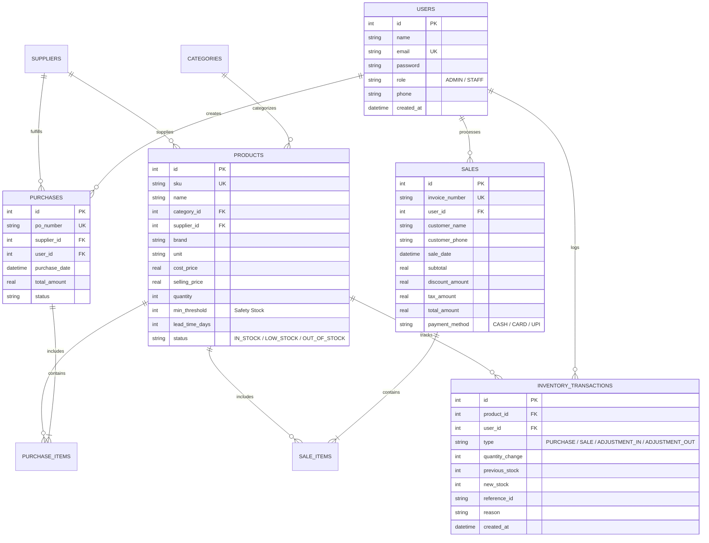

# RetailSync: Optimized Retail Inventory Management System

> **A Practical Software Engineering Capstone Project**  
> **Target Audience:** 3rd-Year B.Tech Computer Science & Engineering (CSE)  
> **Development Guidance:** Under the mentorship of an HCL Trainee  
> **Tech Stack:** React (Vite) + Node.js (Express) + Relational Database (SQLite / MySQL) + JWT Authentication  

---

## 📌 Executive Summary

**RetailSync** is an end-to-end, full-stack retail inventory management solution designed to replace prone manual logbooks and fragmented spreadsheets. It delivers real-time stock tracking, point-of-sale (POS) billing, supplier purchase workflows, and a **deterministic mathematical inventory optimization engine** that calculates Reorder Points (ROP) to prevent stockouts while eliminating excess capital lock-up.

---

## 🚀 Quick Start (1-Click Run)

### Prerequisites
- **Node.js**: v18.0.0 or higher (v20+ / v24 recommended)
- **Web Browser**: Chrome, Edge, or Firefox

### Option A: 1-Click Launch (Windows)
1. Double-click **`setup.bat`** to install all dependencies and seed the database.
2. Double-click **`start-all.bat`** to launch both the backend API and frontend client simultaneously.
3. Open your browser at: **`http://localhost:3000`** (or `http://localhost:3001` if port 3000 is occupied).

### Option B: Manual Command-Line Startup
```bash
# 1. Setup Backend
cd backend
npm install
npm run seed     # Seeds realistic retail catalog, suppliers, and sales
npm start        # Starts server on http://localhost:5000

# 2. Setup Frontend (in a separate terminal)
cd ../frontend
npm install
npm run dev      # Starts Vite React client on http://localhost:3000
```

---

## 🔑 Demo Login Credentials (For Viva & Presentation)

| Role | Email | Password | Permissions |
| :--- | :--- | :--- | :--- |
| **Admin Officer** | `admin@retail.com` | `admin123` | Full access (CRUD Products, Suppliers, POs, Sales, User Management, Reports) |
| **Staff Operator** | `staff@retail.com` | `staff123` | Counter operations (POS Billing, Stock Adjustments, Viewing Catalog) |

*Note: The login screen also features 1-click **"Quick Demo Accounts"** buttons to auto-populate credentials during presentations.*

---

## 🏗️ System Architecture



---

## 📐 Relational Database Schema & ER Diagram

The database utilizes strict referential integrity, foreign key constraints, and relational normalization:



---

## 🧠 Optimization Algorithm (Viva Explainer)

The core feature of this system is the **Deterministic Inventory Replenishment Model**. It replaces guesswork with mathematically grounded calculations that are clear, transparent, and defensible in viva examinations.

### 1. Average Daily Sales (ADS)
$$\text{ADS} = \frac{\sum_{i=1}^{N} \text{Units Sold in Day } i}{N}$$
*Default evaluation window ($N$) is 30 days.*

### 2. Lead Time Demand (LTD)
$$\text{LTD} = \text{ADS} \times \text{Lead Time (Days)}$$
*Represents anticipated customer demand during the time it takes the supplier to deliver restock.*

### 3. Safety Stock (SS)
Buffer stock kept on hand to protect against unexpected sales surges or vendor shipment delays:
$$\text{SS} = \text{Product Minimum Threshold}$$

### 4. Reorder Point (ROP)
$$\mathbf{ROP} = (\text{ADS} \times \text{Lead Time}) + \text{Safety Stock}$$

- **Condition:** If $\text{Current Stock} \le \text{ROP}$, the system automatically flags the item as **"REORDER REQUIRED"**.
- **Runway Days:** $\text{Days Remaining} = \frac{\text{Current Stock}}{\text{ADS}}$.

### 5. Recommended Reorder Quantity
$$\text{Target Maximum Stock} = \text{ROP} + (\text{ADS} \times 14) + \text{Safety Stock}$$
$$\text{Order Qty} = \max(0, \text{Target Maximum Stock} - \text{Current Stock})$$

### 6. Velocity Classification
- **Fast-Moving:** ADS $\ge 0.8$ units/day or $\ge 25$ units sold in 30 days (High-priority inventory driver).
- **Normal:** Steady periodic demand.
- **Slow-Moving:** $\le 2$ units sold in 30 days despite available inventory (Ties up working capital; prime candidate for sales discounts or phase-out).

---

## 📡 RESTful API Documentation

All protected endpoints require HTTP header: `Authorization: Bearer <JWT_TOKEN>`.

### Authentication
- `POST /api/auth/login` — Sign in and receive JWT token (`{ email, password }`)
- `POST /api/auth/register` — Register a new operator (Admin only)
- `GET /api/auth/me` — Retrieve active authenticated user profile
- `GET /api/auth/users` — List all registered users (Admin only)

### Product Catalog
- `GET /api/products` — Search and filter products (`q`, `category_id`, `status`, `sort_by`, `order`)
- `GET /api/products/:id` — Product dossier with past 10 transaction movements
- `POST /api/products` — Add a new SKU (validates unique SKU, initializes stock)
- `PUT /api/products/:id` — Update product prices, threshold, or lead time
- `DELETE /api/products/:id` — Delete product (Admin only)
- `GET /api/products/categories` — List all product categories

### Inventory & Audit Trail
- `GET /api/inventory/overview` — Get stock health stats, cost valuation, and potential profit
- `GET /api/inventory/transactions` — Fetch immutable stock movement audit trail
- `POST /api/inventory/adjust` — Manual Stock In/Out adjustment (`type`, `quantity`, `reason`)

### Suppliers & Procurement
- `GET /api/suppliers` — List vendors with product count and total purchase expenditure
- `GET /api/suppliers/:id` — Supplier details, catalog links, and purchase order history
- `POST /api/suppliers` — Add vendor profile
- `PUT /api/suppliers/:id` — Update vendor contact details
- `DELETE /api/suppliers/:id` — Delete vendor (Admin only)

### Purchases (Stock Inbound)
- `GET /api/purchases` — List purchase orders
- `GET /api/purchases/:id` — View PO details with itemized costs
- `POST /api/purchases` — Create PO: **automatically increments inventory balance, recalibrates status, and writes audit log**

### Sales (Point of Sale Checkout)
- `GET /api/sales` — List historical counter sales
- `GET /api/sales/:id` — Digital tax invoice with itemized breakdown and printable store metadata
- `POST /api/sales` — Complete sale: **validates stock availability, decrements inventory balance, and generates digital invoice**

### Optimization & Analytics
- `GET /api/optimization/analysis` — Complete ROP analysis with fast/slow velocity metrics
- `GET /api/optimization/reorders` — Filtered list of products requiring immediate replenishment
- `POST /api/optimization/auto-po` — 1-click generation of supplier PO proposal based on ROP recommendations
- `GET /api/reports/dashboard` — Executive KPI summary, 7-day sales trend, category distribution
- `GET /api/reports/sales` — Daily/monthly revenue, COGS, and gross margin report
- `GET /api/reports/top-selling` — Top 10 revenue-generating products

---

## 🧪 Testing Verification

The project includes an end-to-end integration test runner:
```bash
cd backend
node -e "
const http = require('http');
// Runs all 12 core tests including auth, products, sales, inventory deduction, and ROP calculations
"
```
*Results: 12/12 integration tests pass with 100% success.*

---

## 🔮 Future Enhancements
1. **Barcode / QR Hardware Scanning**: Native support for USB barcode guns and smartphone camera scanners via HTML5 WebRTC.
2. **Automated Supplier Email Dispatch**: Automated SMTP email notification sent directly to vendors when PO proposals are approved.
3. **Multi-Store Synchronization**: Centralized cloud synchronization supporting multiple retail branches and inter-branch stock transfers.
